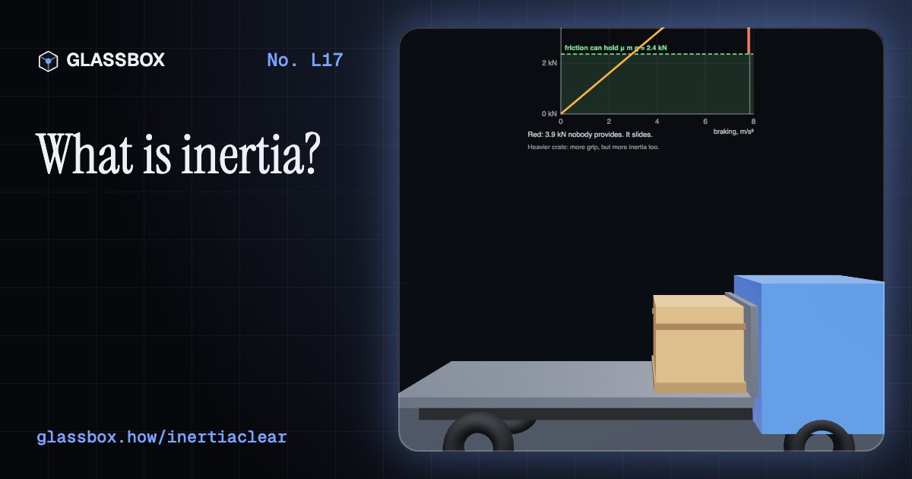
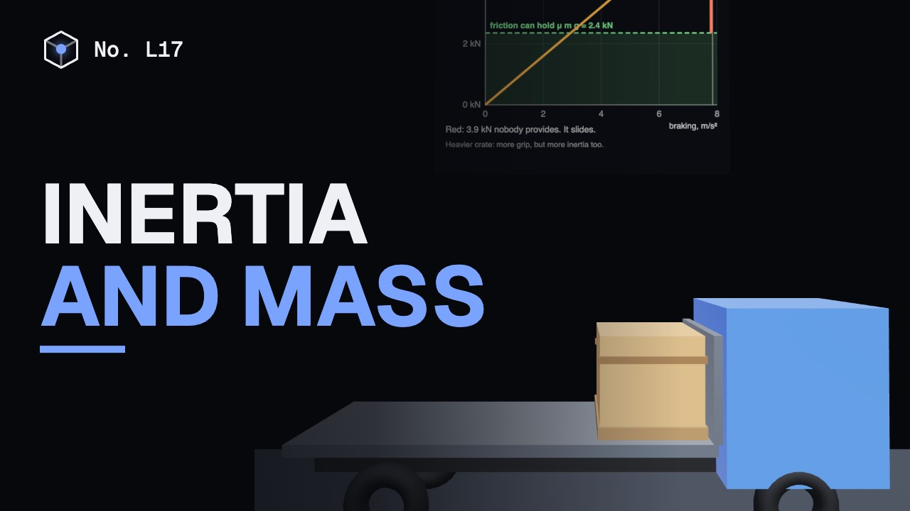
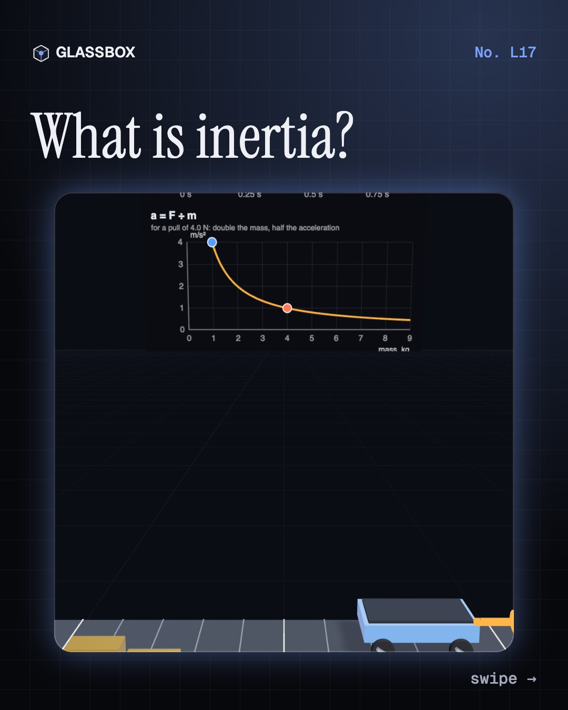
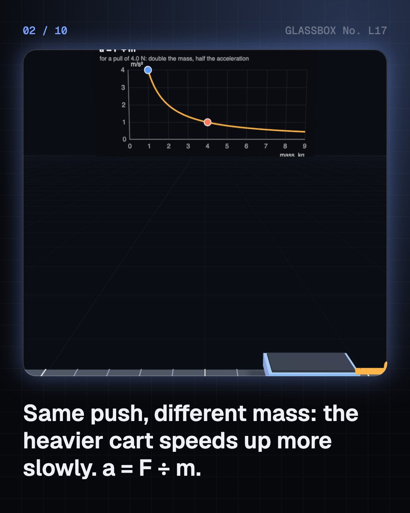
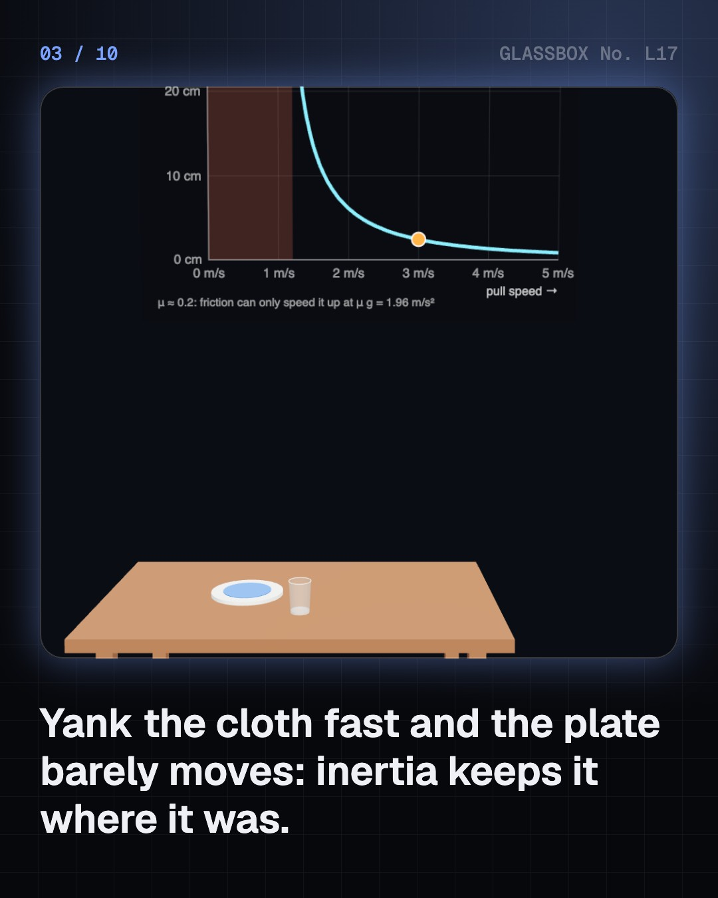
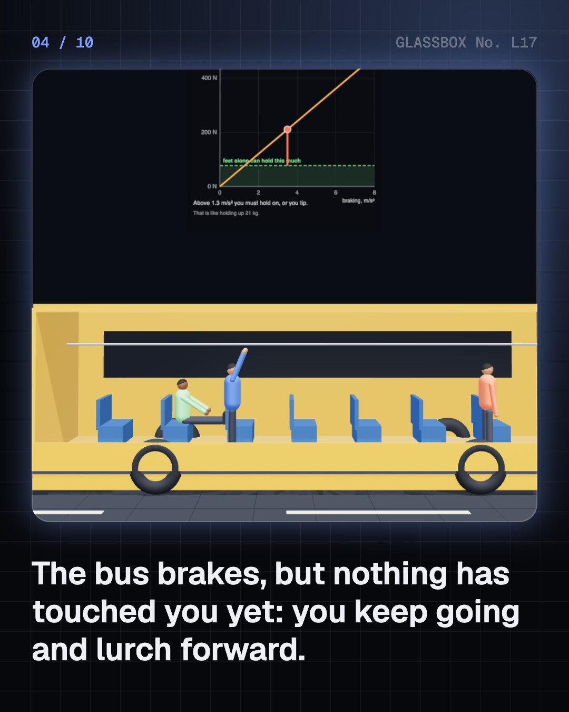

<!-- glassbox:start -->
<!-- Generated from glassbox.json by the Glassbox hub (npm run readme -- inertiaclear). Edit glassbox.json, not this block. -->
<p align="center"><a href="https://glassbox.how/e/inertiaclear/"></a></p>

<h1 align="center">Inertia and mass</h1>

<p align="center"><b>What is inertia?</b><br>Why do you lurch when the bus brakes, and how does a coin drop neatly into a glass when you flick the card away? Push carts, yank a tablecloth, spin a skater, hang a bicycle wheel from a string, weigh an astronaut without weight, and test the most precise coincidence in physics.</p>

<p align="center"><a href="https://glassbox.how/inertiaclear/"><b>▶ Play with it</b></a> &nbsp;·&nbsp; <a href="https://glassbox.how/e/inertiaclear/">Read the 60-second explainer</a> &nbsp;·&nbsp; <a href="https://glassbox.how/inertiaclear/glassbox/reel.mp4">Watch the 40-second video</a></p>

<p align="center">
  <a href="https://glassbox.how/e/inertiaclear/"></a>
  <a href="https://glassbox.how/e/inertiaclear/"></a>
  <a href="LICENSE"></a>
  <a href="LICENSE-CONTENT.md"></a>
  <a href="#privacy"></a>
</p>

## In 60 seconds

1. **Hard to budge.** Inertia is how hard it is to change something's motion, and mass, in kilograms, measures it: the same force gives half the acceleration to twice the mass, a = F ÷ m. Mass is not weight: weight is m g, in newtons, and changes on the Moon. Flick a card or yank a tablecloth fast and inertia keeps the coin and plates where they were.
2. **Riding.** When a bus brakes, you keep going until something pushes you back with F = m a: about 180 N for a 60 kg passenger at 3 m/s². Unaided, you tip beyond about 1.3 m/s². Seat belts, a rider's arms and lorry straps all supply that force; friction alone can hold a load only up to μ g.
3. **Spinning.** For turning, inertia is the moment of inertia I = Σ m r². A skater pulling her arms in cuts I nearly four times, so she spins nearly four times faster, keeping L = I ω. A spinning wheel hung from a string precesses instead of falling, and a flywheel smooths an engine's power strokes.
4. **Measuring mass.** A spring scale measures weight and reads a sixth on the Moon; a balance compares masses and reads true, but fails in orbit. Skylab's crews wobbled on a spring chair (T = 2π √(m ÷ k)); the ISS's SLAMMD pulls with a known force and computes m = F ÷ a.
5. **Myths and limits.** Things don't naturally slow down: friction stops them, and on ice a heavy sledge slides as far as a light one. Inertial and gravitational mass agree to 1 part in 10¹⁵ (MICROSCOPE, 2022), the equivalence principle behind general relativity. 'Relativistic mass' is an old idea; mass today means rest mass.

## Words worth knowing

| Term | Meaning |
|---|---|
| **Inertia** | The tendency of an object to keep still, or keep moving in a straight line at steady speed, until a force acts. |
| **Mass** | The amount of inertia an object has, measured in kilograms: m = F ÷ a. |
| **Weight** | The pull of gravity on a mass, W = m g, in newtons. It changes from place to place; mass does not. |
| **Kilogram** | The SI unit of mass, defined since 2019 by fixing the Planck constant at 6.626 070 15 × 10⁻³⁴ J·s. |
| **Moment of inertia** | Resistance to changes in spin, I = Σ m r², in kg·m². Mass far from the axis counts most. |
| **Angular momentum** | L = I ω. It stays constant unless a torque acts, which is why skaters spin faster with arms in. |
| **Inertial balance** | A mass on springs whose wobble period, T = 2π √(m ÷ k), measures mass without gravity. |
| **Equivalence principle** | Inertial and gravitational mass are the same, so everything falls alike. Tested to about 1 part in 10¹⁵. |

## A short history

**From Aristotle's pushing air to a kilogram set by the Planck constant: 2,400 years of learning why things keep moving.**

- **350 BCE** · Motion needs a mover, says Aristotle (Aristotle, Athens, Greece)
- **1350** · Buridan's impetus (Jean Buridan, Paris, France)
- **1604** · Galileo's rolling balls (Galileo Galilei, Padua, Italy)
- **1618** · Kepler names 'inertia' (Johannes Kepler, Linz, Austria)
- **1638** · Two New Sciences: level motion lasts (Galileo Galilei, Leiden, Netherlands)
- **1687** · Newton's first law, and mass (Isaac Newton, London, England)
- **1889** · The kilogram gets a body (1st General Conference on Weights and Measures, Sèvres, near Paris, France)
- **1889** · Eötvös weighs inertia against gravity (Loránd Eötvös, with Dezső Pekár and Jenő Fekete, Budapest, Hungary)

The full story, with 20 moments, charts, people and 24 sources: [glassbox.how/e/inertiaclear/history](https://glassbox.how/e/inertiaclear/history/). The data lives in [`history.json`](history.json).

## Video and slides

Made with the Glassbox studio from this box's storyboard (`window.glassbox.director`). Free to reuse under CC BY 4.0.

<a href="https://glassbox.how/inertiaclear/glassbox/video.mp4"></a>

<p><a href="glassbox/slide-1.jpg"></a> <a href="glassbox/slide-2.jpg"></a> <a href="glassbox/slide-3.jpg"></a> <a href="glassbox/slide-4.jpg"></a></p>

| File | What | Size |
|---|---|---|
| [`glassbox/reel.mp4`](https://glassbox.how/inertiaclear/glassbox/reel.mp4) | Reel / Short, with captions and soundtrack | 1080×1920 |
| [`glassbox/video.mp4`](https://glassbox.how/inertiaclear/glassbox/video.mp4) | YouTube video, with captions and soundtrack | 1920×1080 |
| `glassbox/slide-1…10.jpg` | Instagram carousel | 1080×1350 |
| `glassbox/thumb.jpg` | YouTube thumbnail | 1280×720 |
| `glassbox/cover.jpg` | Share card and repo social preview | 1200×630 |
| [`glassbox/history-reel.mp4`](https://glassbox.how/inertiaclear/glassbox/history-reel.mp4) | “History in 10 moments” Reel / Short | 1080×1920 |
| `glassbox/history-slide-*.jpg` | History carousel | 1080×1350 |
| `glassbox/post.json` | Post copy and schedule used by the publish kit | |

## Privacy

This box has no accounts and no ads, and it ships its own fonts and libraries. When you run it yourself it sends nothing anywhere. On glassbox.how, the site's `/bar.js` also loads Glassbox's analytics: **Google Analytics** to count visits (it asks first in the EU, UK and Switzerland, and stays off when your browser sends Global Privacy Control or Do Not Track) and **ClickTrust** to detect bots.

It remembers a few things **in your own browser only**, and never sends them anywhere:

| Browser storage key | What it holds |
|---|---|
| `inertiaclear.v1` | Which chapters you have opened, your best quiz scores, and sound on or off. |

Exactly what each one sees is at [glassbox.how/privacy](https://glassbox.how/privacy/).

## Licences

- **Code:** [MIT](LICENSE). Use it, change it, ship it.
- **Explanations, text, images and videos** (`glassbox.json`, `glassbox/`): [CC BY 4.0](LICENSE-CONTENT.md). Credit “Glassbox, glassbox.how/e/inertiaclear”.
- **Third-party parts** keep their own licences: [three.js](https://threejs.org) (MIT), [Geist, Instrument Serif](https://openfontlicense.org) (SIL OFL 1.1).
- The Glassbox name and logo aren't covered by either licence. See the [terms](https://glassbox.how/terms/).

Found a mistake? [Open an issue](https://github.com/bdeeps/inertiaclear/issues). Corrections happen in public.
<!-- glassbox:end -->

## Run it

It's plain HTML, CSS and JavaScript. No build step and no dependencies. Run locally, it contacts no other website.

```bash
python3 -m http.server 8000
```

Three.js and the fonts ship in `vendor/` and `fonts/`, so it also works offline.

Then open http://localhost:8000.

## How it's built

| File | What |
|---|---|
| `index.html`, `css/app.css` | The page and its styles |
| `js/app.js`, `js/stage.js`, `js/ui.js`, `js/kit.js` | The shared Glassbox 3D engine: chapters, 3D stage, controls, quiz, video director |
| `js/inertia.js` | Shared parts for this box: chart boards, arrows, carts, bus, lorry, motorcycle, skater, bicycle wheel, glass and people |
| `js/chapters/*.js` | One file per chapter: the 3D model, controls, text, key terms, quiz and video scenes |
| `glassbox.json` | Title, question, explainer beats, key terms, browser storage and credits shown on glassbox.how |
| `reel` in each chapter | The storyboard the Glassbox studio records into short videos |
| `glassbox/` | The published video, slides, thumbnail and post copy |
| `fonts/`, `vendor/three/` | Self-hosted Geist and Instrument Serif (SIL OFL 1.1) and three.js (MIT) |
